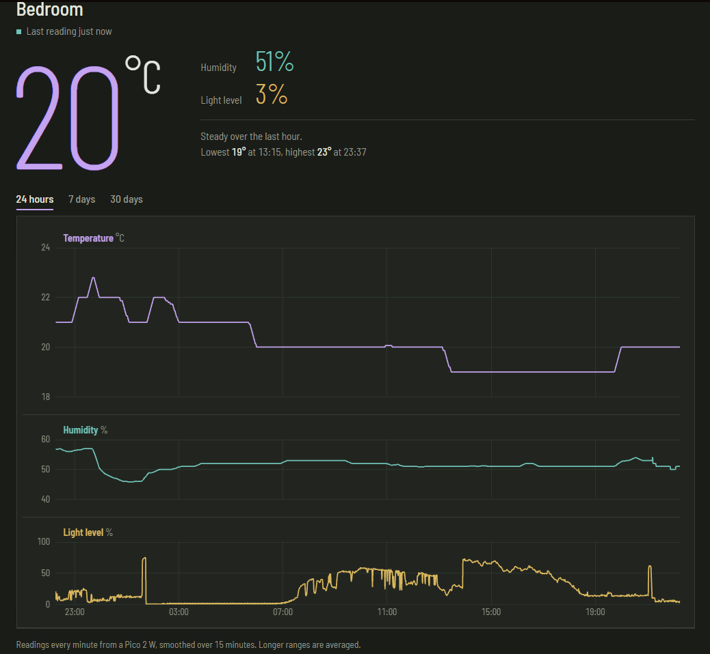
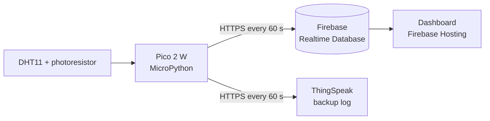
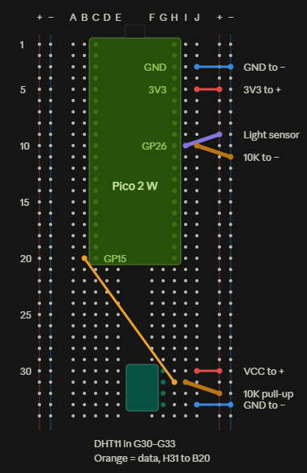

# Pico Sensor Node

A Wi-Fi sensor node that logs room temperature, humidity and light level to the cloud every minute, around the clock, with a live web dashboard to view the history.

It runs on a Raspberry Pi Pico 2 W with MicroPython, stores readings in Firebase Realtime Database, and serves the dashboard from Firebase Hosting. No PC needs to be switched on for it to keep logging.

**Live dashboard:** [https://pico-sensor-2b8f8.web.app] (NOTE: INACTIVE)



## How it works



1. Every 60 seconds the Pico reads temperature and humidity from a DHT11 sensor and light level from a photoresistor.
2. It signs in to Firebase as its own user account, then writes the reading to the database over the REST API. Firebase stamps each reading with its server time, since the Pico has no real-time clock.
3. Each reading goes to two places: `readings` keeps the full history, and `latest` holds only the newest reading so the dashboard can show current values with one small read.
4. The dashboard loads only the time range you choose, then listens to `latest` so new readings appear without a page refresh.
5. A copy of each reading is also sent to ThingSpeak as an independent backup log.

## Hardware

| Part | Notes |
|---|---|
| Raspberry Pi Pico 2 W | Any micro USB phone charger powers it |
| DHT11 temperature and humidity sensor | Bare 4-pin version, with a 10 kΩ pull-up on the data line |
| Photoresistor | Wired as a voltage divider with a 10 kΩ resistor |
| 2 × 10 kΩ resistors | Brown, black, orange |
| Breadboard and jumper wires | |

### Wiring

| Pico pin | Connects to |
|---|---|
| 3V3(OUT), pin 36 | + rail |
| GND, pin 38 | − rail |
| GP15, pin 20 | DHT11 data, with 10 kΩ from data to + rail |
| GP26 / ADC0, pin 31 | Junction of photoresistor (to + rail) and 10 kΩ (to − rail) |
| DHT11 VCC and GND | + rail and − rail |



## Repository layout

```
pico-sensor-node/
├── firmware/
│   ├── main.py               Reads sensors, handles Wi-Fi, sends readings
│   ├── firebase.py           Firebase sign-in, token refresh and writes
│   └── secrets.example.py    Template for your own secrets.py
├── dashboard/
│   ├── firebase.json
│   └── public/index.html     The dashboard (Chart.js, no build step)
└── docs/                     Photos and screenshots
```

## Setup

### 1. Firebase project
1. Create a Firebase project and a Realtime Database (I used `europe-west1`).
2. Under **Authentication**, enable Email/Password and add a user for the Pico. Copy its User UID.
3. Paste these rules into **Realtime Database → Rules**, replacing `PICO_UID`:

```json
{
  "rules": {
    "devices": {
      ".read": true,
      "$device": {
        ".write": "auth != null && auth.uid === 'PICO_UID'",
        "readings": {
          ".indexOn": ["ts"],
          "$id": { ".validate": "newData.hasChildren(['t', 'h', 'l', 'ts'])" }
        }
      }
    }
  }
}
```

Only the Pico's account can write, and malformed readings are rejected. Reads are public so the dashboard works without a login.

### 2. Firmware
1. Flash the MicroPython firmware for the **Pico 2 W** from [micropython.org](https://micropython.org/download/RPI_PICO2_W/).
2. Copy `firmware/secrets.example.py` to `firmware/secrets.py` and fill in your Wi-Fi details, Firebase settings and ThingSpeak key. `secrets.py` is in `.gitignore`.
3. Upload the `firmware` folder to the Pico. I used VS Code with the [MicroPico](https://github.com/paulober/MicroPico) extension. `main.py` runs automatically on power-up.

The Pico 2 W only supports 2.4 GHz Wi-Fi.

### 3. Dashboard
1. Paste your web app's `firebaseConfig` into `dashboard/public/index.html`.
2. From the `dashboard` folder, run:

```
npm install -g firebase-tools
firebase login
firebase deploy --only hosting
```

## Data format

```json
"devices": {
  "bedroom": {
    "latest":   { "t": 19, "h": 54, "l": 22, "ts": 1760130000000 },
    "readings": {
      "-Nx8a...": { "t": 19, "h": 54, "l": 22, "ts": 1760130000000 }
    }
  }
}
```

`t` is °C, `h` is relative humidity in %, `l` is light level as a percentage of the ADC range, and `ts` is the server timestamp in milliseconds.

## Reliability

The node is meant to run unattended, so the firmware is built to recover by itself:

- **Watchdog timer:** a hardware watchdog reboots the Pico if the code hangs for more than 8 seconds.
- **Wi-Fi reconnect:** each cycle checks the connection and reconnects if the router has dropped it.
- **Token refresh:** Firebase sign-in tokens expire after an hour, so the Pico signs in again every 50 minutes.
- **Independent sends:** Firebase and ThingSpeak are sent in separate error handlers, so one failing doesn't stop the other.
- **Offline warning:** the dashboard shows a warning if no reading has arrived for 5 minutes.

I tested recovery by switching the router off for a minute while it was running. It reconnected by itself, leaving only a short gap in the graph.

## Dashboard notes

- The DHT11 only reports whole degrees, so a day of raw readings flickers between neighbouring values. The 24-hour view uses a centred 15-minute rolling average to show the real trend.
- The 7-day and 30-day views average readings into 10-minute and 1-hour buckets, which keeps them fast and stays well inside Firebase's free bandwidth.
- Temperature, humidity and light share one time axis, so you can line up events, such as the light coming on and the temperature rising after it.

## What I learned

- How a microcontroller authenticates to a cloud service using short-lived tokens, and why the device should have its own account instead of an open database.
- Watchdog timers and designing firmware to recover from failures without anyone there to restart it.
- Wiring sensors safely to a 3.3 V board, including pull-up resistors and voltage dividers.
- Querying time-series data efficiently and averaging it so long ranges stay usable.
- The publish/subscribe model, from an earlier version of this project that sent readings over MQTT to a Mosquitto broker on my PC.

## Next steps

- [ ] Login on the dashboard, then make reads private
- [ ] Second sensor node in another room, with a room picker
- [ ] Alerts for high humidity or temperature
- [ ] Battery power using deep sleep between readings
- [ ] Swap the DHT11 for a more precise sensor, such as a BME280

## Licence

[MIT](LICENSE)
